# Instructivo de Carmesí

Guía práctica del sistema de gestión de la academia, organizada por perfil: **Admisión**, **Administración** y **Dirección**. Cada perfil puede hacer todo lo del anterior y algo más, así que Administración lee también la parte de Admisión, y Dirección las tres.

> Regla general: el sistema nunca borra ni reescribe un pago, una cuota o un cierre de caja. Toda corrección queda registrada aparte, con quién la hizo, cuándo y el **motivo**. Escribí motivos claros: es lo que se lee después en Auditoría.

## Quién puede hacer cada cosa

| Acción                                                                  | Admisión | Administración | Dirección |
| ----------------------------------------------------------------------- | -------- | -------------- | --------- |
| Registrar cobros (cuotas, clase suelta, otros, deuda anterior)          | Sí       | Sí             | Sí        |
| Cobrar a un alumno eventual                                             | Sí       | Sí             | Sí        |
| Dejar como saldo a favor lo que se cobra de más                         | Sí       | Sí             | Sí        |
| Usar el saldo a favor en cuotas u otros cobros                          | Sí       | Sí             | Sí        |
| Cambiar el vencimiento de una cuota                                     | Sí       | Sí             | Sí        |
| Cambiar modalidad y día de pago                                         | Sí       | Sí             | Sí        |
| Reactivar una inscripción finalizada                                    | Sí       | Sí             | Sí        |
| Registrar clases de prueba                                              | Sí       | Sí             | Sí        |
| Abrir y cerrar su turno de caja                                         | Sí       | Sí             | Sí        |
| Elegir qué cuotas paga el alumno y cargar la fecha real del pago        | No       | Sí             | Sí        |
| Corregir, reimputar o anular pagos                                      | No       | Sí             | Sí        |
| Devolver saldo a favor (autorización de Charo)                          | No       | No             | Sí        |
| Conceptos de cobro y cierres semanales y mensuales                      | No       | Sí             | Sí        |
| Quitar recargo, becas del profesor y descuentos                         | No       | Sí             | Sí        |
| Pasar una cuota a otra clase                                            | No       | Sí             | Sí        |
| Anular una cuota generada por error (sin pagos)                         | No       | Sí             | Sí        |
| Corregir la declaración de un cierre y registrar la entrega de efectivo | No       | Sí             | Sí        |
| Borrar clases de prueba sin registros                                   | No       | Sí             | Sí        |
| Repartos de liquidación por clase                                       | No       | Sí             | Sí        |
| Beca de Dirección, cerrar y reabrir la liquidación, usuarios            | No       | No             | Sí        |

# Parte 1 · Admisión

## Inicio

Al entrar se ve el día (pestaña **Hoy**): lo primero que hay que hacer, los demás pendientes, la deuda pendiente y lo cobrado hoy, las clases y los seguimientos. **Registrar pago** abre el cobro desde cualquier lugar. La pestaña **Este mes** muestra el tablero.

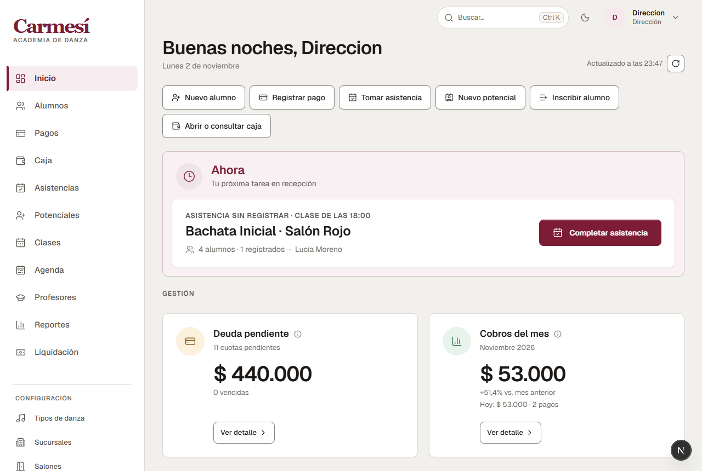

## Inicio → Este mes (tablero)

En **Inicio → Este mes** se ve cómo viene la academia mes a mes. Con las flechas de arriba a la derecha se cambia de mes; todo se compara con el mes anterior.

- **Alumnos activos, altas y bajas**, con los últimos 6 meses y el motivo de las bajas.
- **Clases:** cuántos inscriptos tiene cada una sobre su cupo (marca las de ocupación **Baja** y las **Completas**), sus altas y bajas y la asistencia del mes.
- **Potenciales alumnos:** de las consultas cargadas en el mes, cuántas hicieron la clase de prueba y cuántas se inscribieron.
- **Para hacer:** accesos a los alumnos con cuotas vencidas, a los potenciales sin inscribir y a las clases con lugar.

Administración y Dirección ven además los importes: lo recaudado, la cobranza de las cuotas del mes (cobrado, pendiente y vencido), la deuda vencida, y la recaudación por medio de pago, por concepto y por clase.

## Registrar un pago

1. Tocá **Registrar pago** y buscá al alumno por nombre, apellido o DNI. Con las flechas y Enter se elige sin mouse.
2. En **Cuotas** aparecen las pendientes, de la más vieja a la más nueva, con el total precargado.
3. Si paga una parte, bajá el importe: se aplica desde la cuota más vieja y queda el saldo pendiente.
4. Elegí el medio: **Efectivo**, **Mercado Pago**, **Transferencia**, **Tarjeta** o **Mixto** (varios medios a la vez).
5. Tocá **Cobrar**. Al terminar se ofrece **Enviar recibo por WhatsApp**, cobrar otra cosa al mismo alumno o pasar a otro.

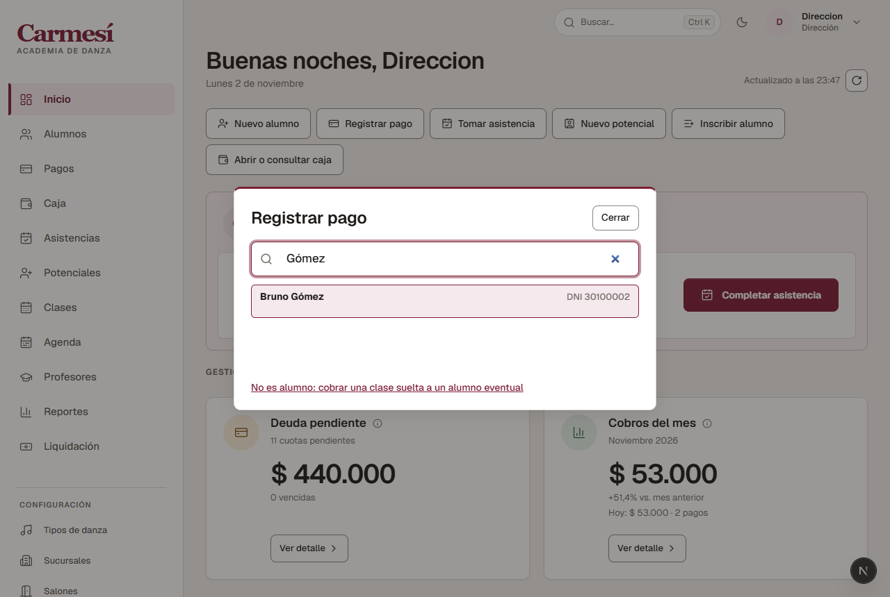

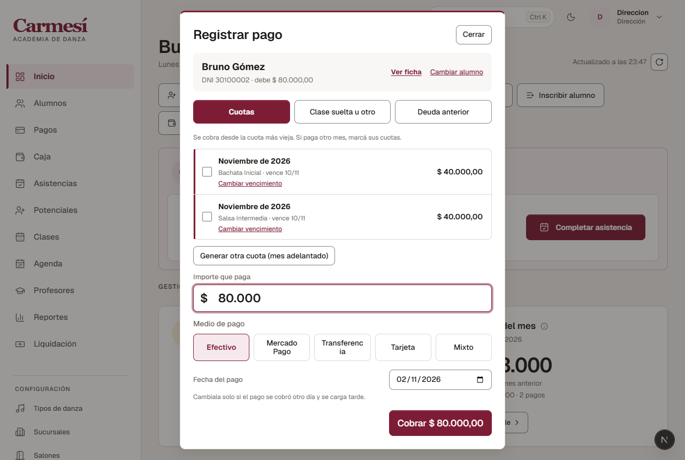

> Para cobrar hace falta tener el **turno de caja abierto**. Si está cerrado, el mismo popup ofrece abrirlo.

**Si viene a pagar un mes que no está cargado**, usá **Generar cuota** (o **Generar otra cuota (mes adelantado)**) y después cobrala.

**Si paga con tarjeta**, elegí **Débito 4,04 %** o **Crédito 7,80 %**: el sistema calcula el recargo sobre lo que se paga con tarjeta y lo muestra antes de cobrar. Se cobra aparte con tarjeta, suma a la recaudación pero no a la liquidación del profesor, y queda ligado al cobro: si se anula el cobro, se anula también el recargo.

### Si paga de más: saldo a favor

Si el importe supera lo que debe, el popup lo avisa: **Paga $X de más: dejarlo como saldo a favor**. Marcá la casilla solo si el alumno efectivamente deja ese dinero. El saldo **no se aplica solo**: queda para lo que el alumno elija.

**Usar el saldo a favor** (cualquiera que cobra, también Admisión): el alumno elige en qué lo usa.

- **En cuotas**: el cobro lo muestra arriba de las cuotas con el botón **Usar saldo a favor**, que lo aplica a las cuotas pendientes de la más vieja a la más nueva, sin pasar por la caja. Si está al día, primero generá la cuota que viene a pagar.
- **En otros cobros** (clase suelta, talleres, indumentaria, Gala…): en **Clase suelta u otro**, escribí cuánto se paga con el saldo en **Usar saldo a favor**; el resto se cobra con los medios de siempre (puede ser nada). Se descuenta del saldo y queda registrado quién lo usó.

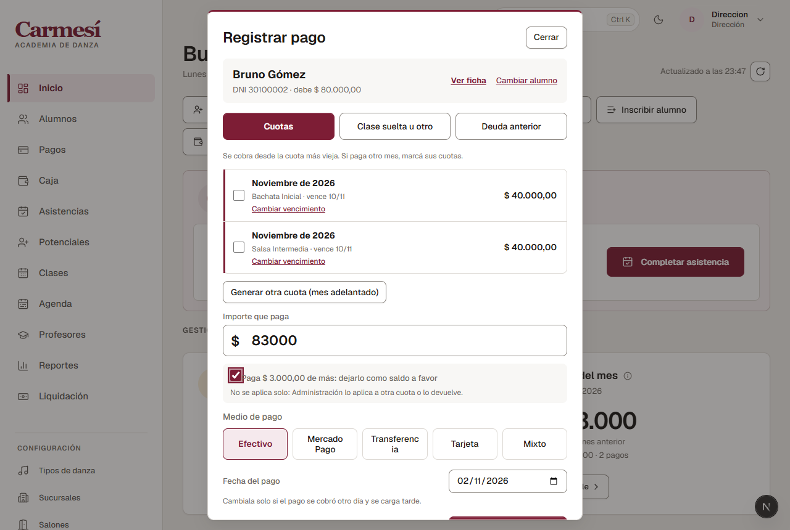

### Clase suelta, indumentaria y otros cobros

En **Clase suelta u otro** se elige el concepto: **Clase suelta** (con la clase y el profesor que la dictó), uno de los **conceptos de cobro** (Formaciones docentes, Inscripciones, Workshops y talleres, Indumentaria, Entradas o precintos de la Gala, Otros —este con detalle obligatorio— y los que agregue Administración) o **Recargo por tarjeta** (solo para un caso excepcional cargado a mano).

### Alumno eventual (no es alumno de la academia)

Para alguien que viene a una clase suelta y no es alumno regular:

1. En el buscador de **Registrar pago**, tocá **No es alumno: cobrar una clase suelta a un alumno eventual**.
2. Escribí el nombre y apellido. Teléfono y DNI son opcionales, pero el teléfono sirve para mandarle el recibo.
3. Elegí la clase, el profesor que la dictó, el importe y el medio, y cobrá.

No se le crea ficha ni cuotas y no cuenta como alumno, pero el cobro suma a la recaudación y a la liquidación del profesor. En el historial y en la caja aparece como "Nombre (eventual)".

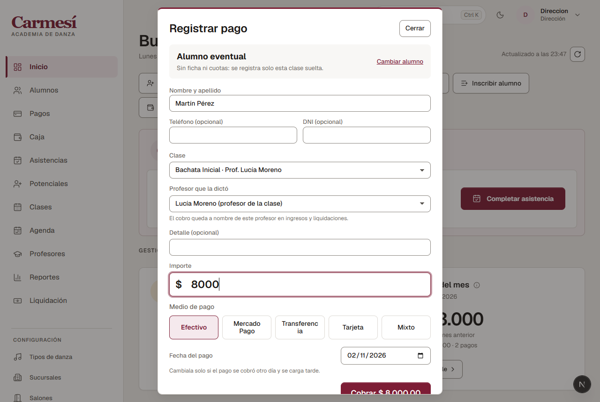

### Deuda anterior

Para deuda que el alumno ya tenía y el sistema no conoce (por ejemplo, la que no vino de ControlFit): pestaña **Deuda anterior**, elegí la clase, escribí a qué corresponde y el monto. Después se cobra como cualquier cuota.

## Ficha del alumno

Desde **Alumnos** se abre la ficha: clases actuales, cuotas, asistencia y pagos recientes.

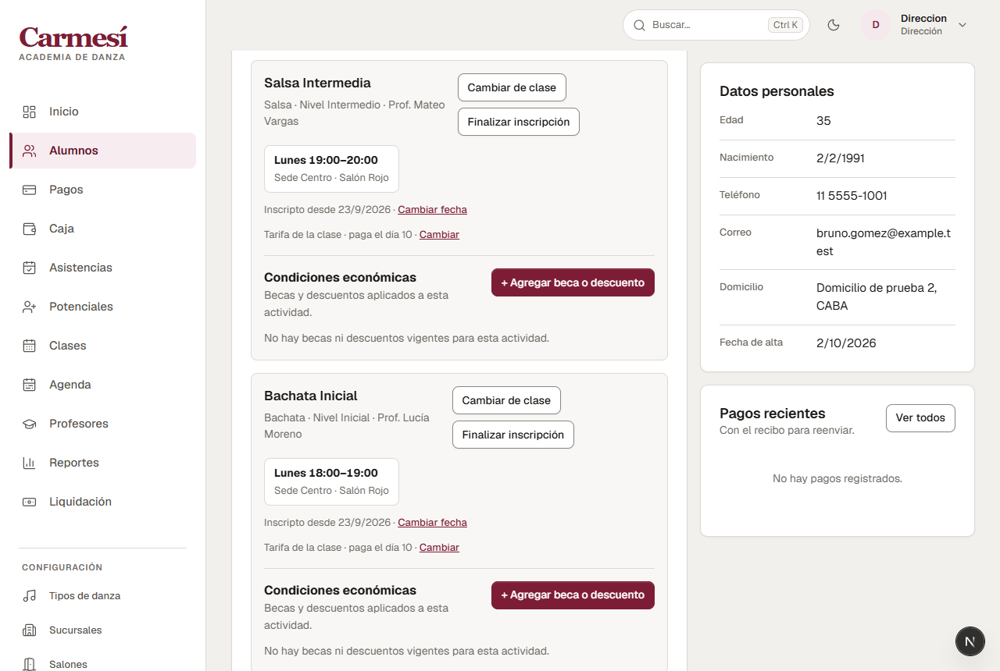

- **Modalidad y día de pago**: en cada clase, la línea con la modalidad (por ejemplo, Completa o Reducida) y el día de pago tiene **Cambiar**. Vale para las cuotas que se generen después.
- **Cambiar vencimiento**: en la tabla **Cuotas**, columna **Vence**, cada cuota con saldo tiene **Cambiar vencimiento** (dentro del mismo mes, con motivo). También está en cada cuota del popup de cobro.
- **Reactivar**: en **Historial de inscripciones**, una inscripción finalizada se puede reactivar si el alumno vuelve a la misma clase.

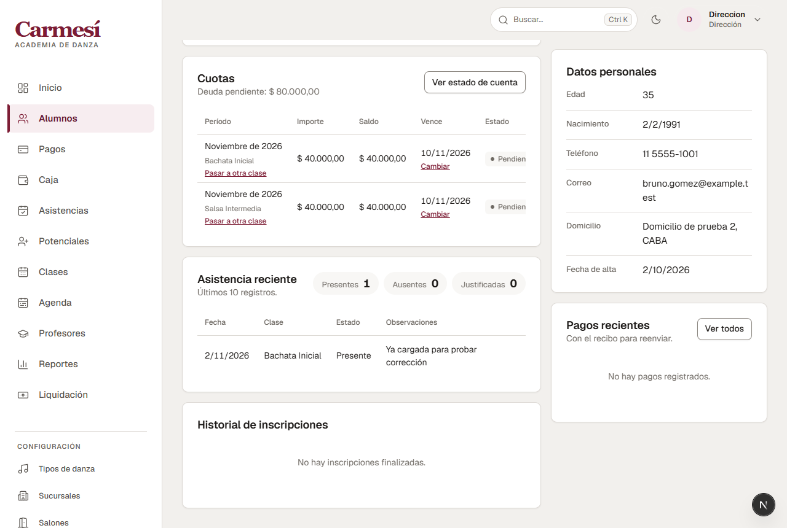

## Clases de prueba (potenciales alumnos)

La primera clase de cada disciplina es gratis y **se prueba una sola vez por clase**. Se registra en el potencial alumno, no en asistencias: no genera deuda ni inscripción.

1. En **Potenciales**, abrí (o creá) al potencial alumno.
2. En **Clases de prueba**, elegí la clase y la fecha, y tocá **Registrar clase de prueba**.
3. Si ya probó esa clase, el sistema no deja cargarla de nuevo y lo muestra en el selector como "ya la probó".

Al registrar la primera prueba, el potencial pasa a la etapa **Clase de prueba**. Una prueba cargada por error se quita con **Quitar** (pide motivo).

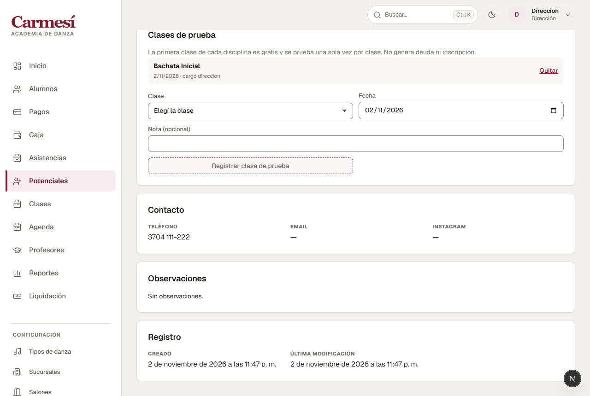

## Mensajes de WhatsApp

En **Mensajes** hay mensajes ya escritos para cada situación y la lista de personas a las que les corresponde.

1. Elegí la situación a la izquierda: cuota por vencer, cuota vencida, faltó varias veces, dejó hace poco, bienvenida, cumpleaños, o potenciales que consultaron o probaron y no se inscribieron. El número indica cuántas personas hay hoy.
2. Arriba se ve el mensaje tal como va a llegar, con el nombre y los datos de la persona ya completados. Si la situación tiene más de un mensaje (por ejemplo "Recordatorio amable" y "Segundo aviso"), elegí cuál usar.
3. En la lista, tocá **Enviar por WhatsApp**: se abre el chat con el texto escrito. Revisalo, retocalo si hace falta y envialo desde WhatsApp.
4. La persona pasa a **Avisados**, con la fecha y quién le escribió, para no repetir. Desde ahí se puede **Volver a enviar**.

Si alguien no tiene teléfono, **Cargar teléfono** lleva a su ficha. El sistema no envía nada solo: siempre lo manda quien está usando el panel, desde su WhatsApp.

Administración y Dirección pueden cambiar los textos con **Editar mensaje** o sumar otros con **Nuevo mensaje**. Los botones "+ nombre", "+ saldo vencido", etc. insertan el dato que se completa solo; los emojis se escriben como en cualquier chat.

## Caja: mi turno

Cada cobro entra solo en el turno de quien cobra, separado por medio de pago.

1. Al empezar, **Abrir turno** (o abrirlo desde el popup de cobro).
2. Al terminar, **Cerrar turno**: declarás cuánto tenés de cada medio. Las diferencias no impiden cerrar; quedan registradas.

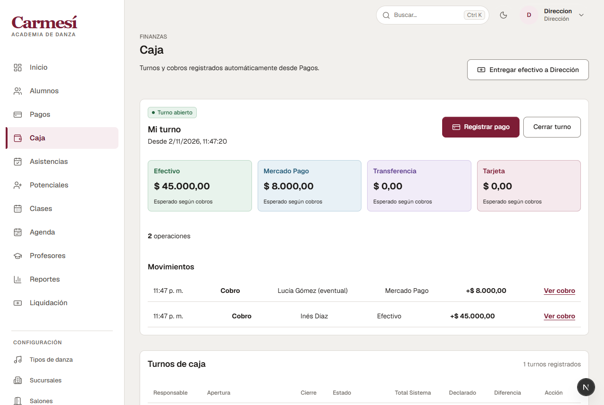

# Parte 2 · Administración

## Estado de cuenta

Desde la ficha, **Ver estado de cuenta** (o **Pagos → Cuentas por cobrar** → el alumno). Arriba se ve el alumno en una línea, con DNI, teléfono, deuda, vencidas y **saldo a favor**. A la izquierda está el cobro y a la derecha sus pagos con **WhatsApp**, **Corregir** (o **Saldo a favor**, si le queda saldo) y **Anular**.

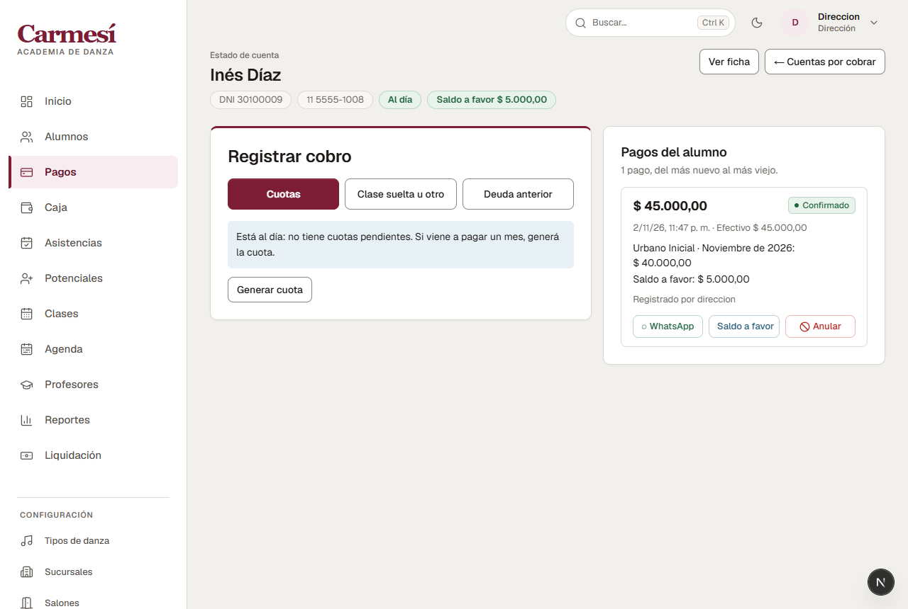

**Elegir qué cuotas paga**: en el cobro, Administración y Dirección marcan las cuotas que el alumno quiere pagar. Si no marcan ninguna, se aplica desde la más vieja.

**Fecha real del pago**: en el cobro, **Fecha del pago** sirve para un pago que se cobró otro día y se carga tarde. El recargo se decide con esa fecha.

## Corregir un pago

**Corregir** abre tres opciones.

### Medio, importe o fecha

Para un pago que existió pero se cargó mal (por ejemplo, en Efectivo cuando fue Mercado Pago). El original queda **Corregido** y se registra uno nuevo. La caja se corrige en el turno donde se cobró, aunque ya esté cerrado.

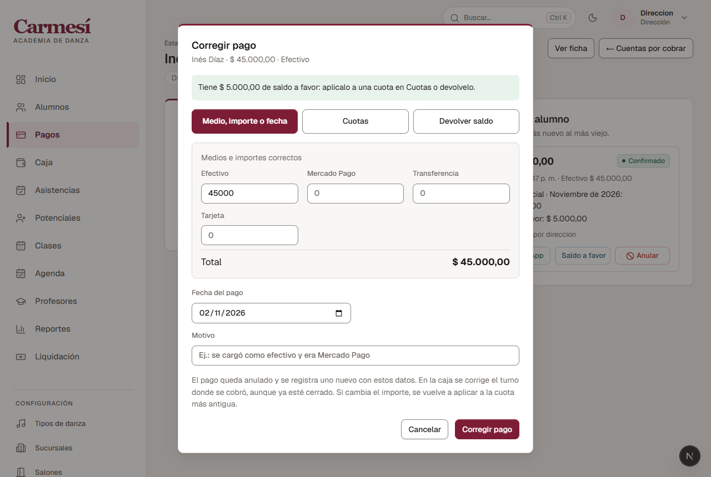

### Cuotas: reimputar, o pasar a saldo a favor

Cambia a qué cuotas se aplicó el pago, **sin tocar la caja**. Escribí cuánto va a cada cuota:

- para pasar un pago de septiembre a octubre, poné el importe en octubre y vaciá septiembre;
- **lo que no se aplique queda como saldo a favor**: para un **pago duplicado**, vaciá todas las cuotas y el pago entero queda a favor;
- para **aplicar un saldo a favor**, escribí el importe en la cuota que corresponde.

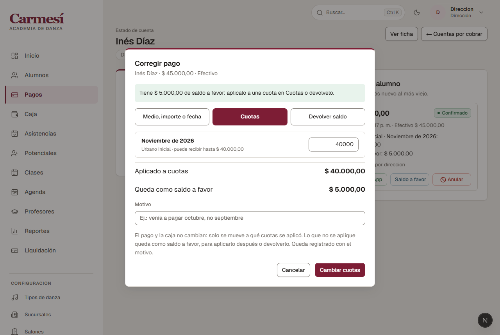

### Devolver saldo

Solo **Dirección** (las devoluciones las autoriza Charo). Devuelve todo o parte del saldo a favor de un pago: elegí el importe, **cómo se devuelve** y el motivo. Por **Mercado Pago, transferencia o tarjeta** queda registrada fuera de la caja (la hace Charo desde su cuenta). En **efectivo**, marcá **Sale de la caja de mi turno abierto** si sale del cajón (egreso del turno); si no, queda fuera de la caja (efectivo que guarda Dirección). Un pago con devoluciones ya no se puede anular ni corregir.

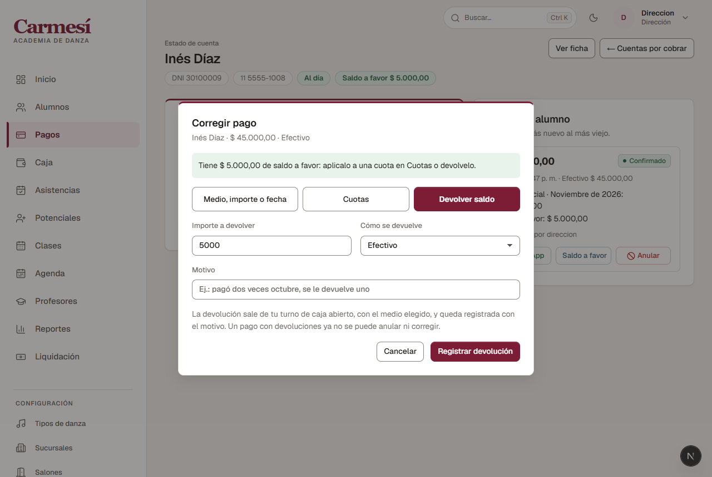

> Pago duplicado: elegí una de tres opciones. **Anular** si el cobro no existió; **Corregir → Cuotas** vaciando las cuotas para dejarlo a favor del mes siguiente; o eso mismo y después **Devolver saldo** para devolver el dinero.

## Anular un pago

**Anular** con motivo, para un cobro que no existió (cargado dos veces o al alumno equivocado). La deuda vuelve a quedar pendiente y en la caja se registra la reversa en el turno original. Si el cobro tenía recargo por tarjeta ligado, se anula también.

## Avisar vencidos

**Pagos → Cuentas por cobrar**, vista **Vencidas**: cada alumno tiene **Avisar**, que abre WhatsApp con el aviso ya escrito (cuotas vencidas, saldo y fecha de la más antigua). Revisalo y envialo; si la ficha no tiene un teléfono válido, WhatsApp te pide elegir el chat. El sistema no manda nada solo.

## Historial de cobros

**Pagos → Historial de cobros**: todos los cobros con filtros por fecha, medio y alumno (también los eventuales). Cada uno muestra en qué se aplicó, el saldo a favor y lo devuelto.

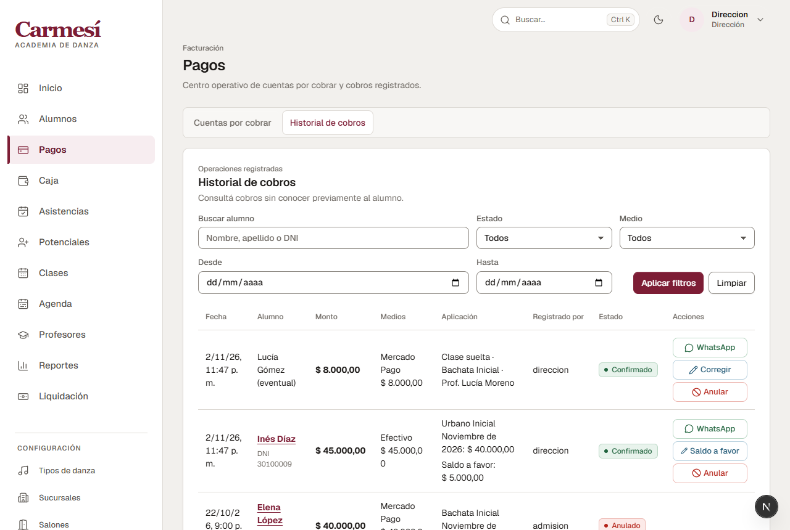

## Excepciones de cuotas

- **Anular cuota**: para una cuota generada por error (un mes que no correspondía). En el cobro o el estado de cuenta, en la cuota, **Anular cuota** con motivo. Solo si no tiene pagos: si los tiene, primero **Corregir → Cuotas** en el pago para pasarlo a la cuota que corresponde (lo que sobre queda como saldo a favor). La cuota queda anulada, deja de ser deuda y ese mes se puede volver a generar.

- **Quitar recargo**: en el estado de cuenta, en la cuota con recargo. Si el recargo ya se cobró, primero se anula el pago.
- **Pasar una cuota a otra clase**: en la ficha, tabla Cuotas, **Pasar a otra clase** debajo del nombre de la clase. Se usa cuando un alumno pagó una clase y se cambió a otra: no se le cobra de nuevo.
- **Becas y descuentos**: en la ficha, en cada clase, **+ Agregar beca o descuento**. La beca del profesor es del 100%; el descuento del profesor es por porcentaje o monto fijo. Cada condición tiene **Renovar** y **Finalizar**.

## Caja: control

- **Corregir declaración**: en el historial de turnos, abrí el turno → **Detalle del turno** → **Corregir declaración** (medio, importe correcto y motivo). El cierre original no se modifica.
- **Entregar efectivo a Dirección**: botón en Caja. Registrás el período, lo entregado y a quién; el sistema muestra cuánto efectivo entró en ese período y la diferencia. No es un gasto ni cambia la caja.

## Clases

El listado abre con las **activas**. Las inactivas (archivadas) se ven eligiendo "Inactivas" o "Todos" en Estado. Desactivar una clase la archiva sin perder su historial.

Una clase creada en las pruebas que **no tiene inscripciones, cobros ni clases de prueba** se puede borrar: en la ficha de una clase inactiva, **Borrar clase de prueba** (con motivo). Si tiene registros, el sistema no la borra y hay que dejarla desactivada.

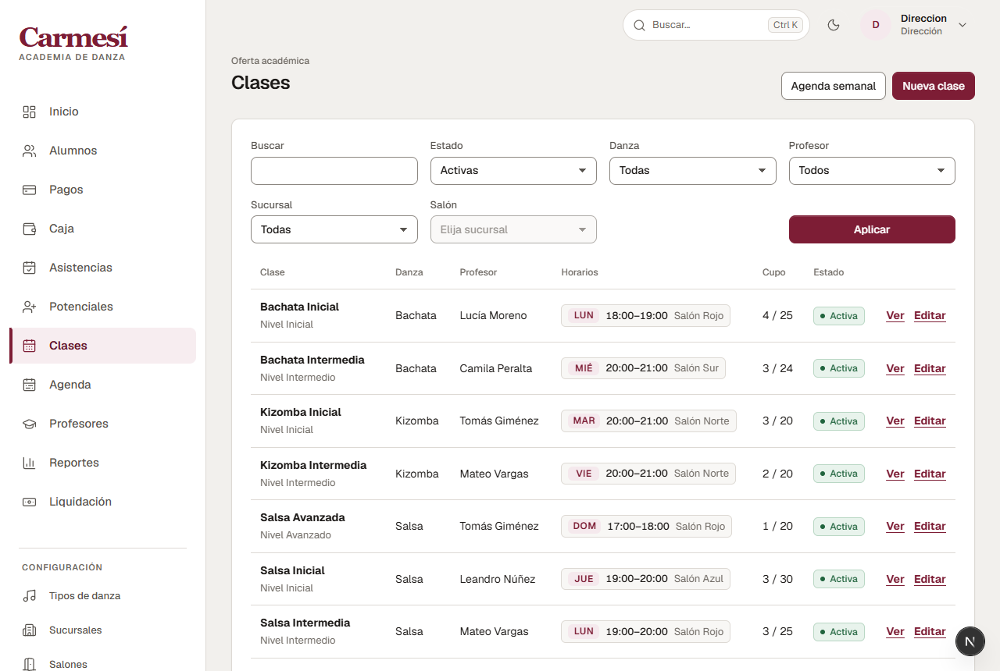

## Conceptos de cobro

**Configuración → Conceptos de cobro**: los conceptos que se eligen en **Clase suelta u otro** y que separan la recaudación. Se agregan, se renombran y se marca si piden contar qué se cobró. Un concepto que ya tiene cobros no se borra: se **desactiva** y deja de aparecer al cobrar.

## Cierres semanales y mensuales

**Cierres** arma solo el reporte del próximo período y lo guarda como una **foto** con **Guardar cierre**:

- **Semanal**: propone desde el día siguiente al último cierre (hasta 7 días, como mucho hasta ayer); se pueden cambiar las fechas. Muestra la recaudación por concepto y por medio (efectivo, Mercado Pago, transferencia, tarjeta), con totales, y las devoluciones del período.
- **Mensual** (para Charo): un mes ya terminado, con la recaudación por concepto y medio, alumnos activos, nuevos ingresos, bajas, cuotas pendientes y montos adeudados.

Un cierre guardado no cambia. Al abrirlo (**Ver**) se ve la foto y, aparte, las **correcciones posteriores al cierre**: lo que hoy da distinto porque se corrigió o anuló un pago después. **Descargar o imprimir PDF** lo abre listo para imprimir. Dirección los consulta desde su usuario.

Para mirar cualquier otro rango, **Reportes → Cobros** muestra la misma recaudación por concepto y medio (en "Detalle por concepto y medio", y también en PDF). En Reportes, **Resumen** compara lo cobrado y las altas con el período anterior de igual largo, y **Profesores**, **Deudores**, **Asistencia** y **Caja** tienen cada uno su pestaña.

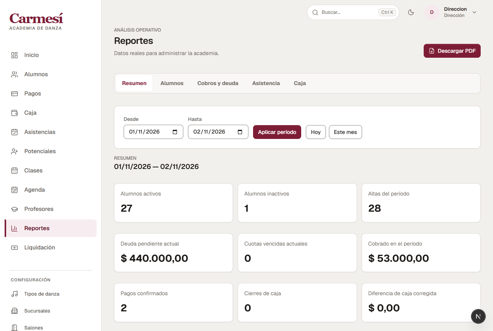

# Parte 3 · Dirección

## Liquidación de profesores

**Liquidación** muestra, para el mes, lo cobrado (también cuotas atrasadas) repartido según el porcentaje de cada clase.

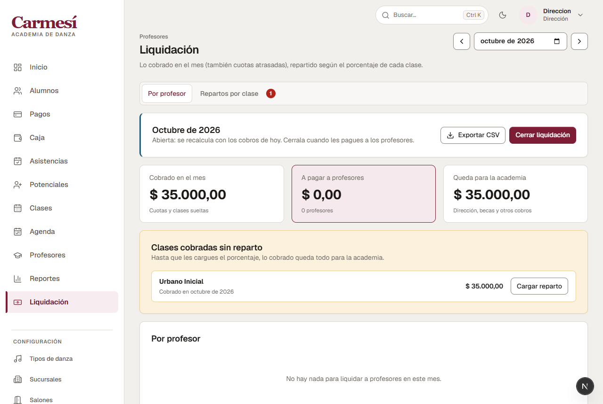

- **Repartos por clase**: el porcentaje de cada profesor desde un mes; lo que no se reparte queda para la academia. Las clases cobradas sin reparto aparecen con **Cargar reparto**. Administración también puede cargarlos.
- **Cerrar liquidación**: cuando se les paga a los profesores. Queda guardada como estaba, aunque después se corrija un pago. Se puede reabrir con motivo.
- **Exportar CSV** con el detalle por profesor.

## Beca de Dirección, usuarios y auditoría

- **Beca de Dirección** (100%): solo Dirección, en la ficha → clase → **+ Agregar beca o descuento**.
- **Usuarios**: alta, perfil (Admisión, Administración, Dirección) y desactivación.
- **Auditoría**: el registro de todos los cambios, con usuario, fecha y motivo.

# Pendientes de confirmar con la PO

Estas reglas se programaron con un criterio provisorio y se ajustan si no son como trabaja la academia:

- Recargo por tarjeta: se redondea al centavo y también va en otros cobros pagados con tarjeta.
- Cierres: el sistema propone el período y arma el reporte, y Administración lo guarda (no se genera solo en una fecha); las **bajas** del mes son los alumnos con una inscripción finalizada en el mes y ninguna activa al cerrar.
- "Formaciones docentes" es un concepto de otros cobros; las cuotas mensuales de una clase de formación siguen en Cuotas.
- Entrega semanal de efectivo a Charo: está disponible en Caja; falta que Charo confirme si la quiere usar.
- Clase de prueba: se registra en el potencial alumno y repetir la misma clase se bloquea.
- Alumno eventual: alcanza con el nombre y no se vincula a una ficha si después se inscribe.
- Borrar clases: qué cuenta como registro real y quién puede borrar.
- Adjuntar el comprobante de una transferencia queda para más adelante (hace falta guardar archivos).
